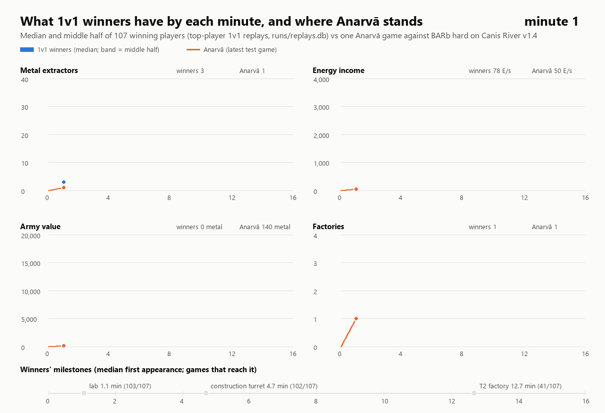
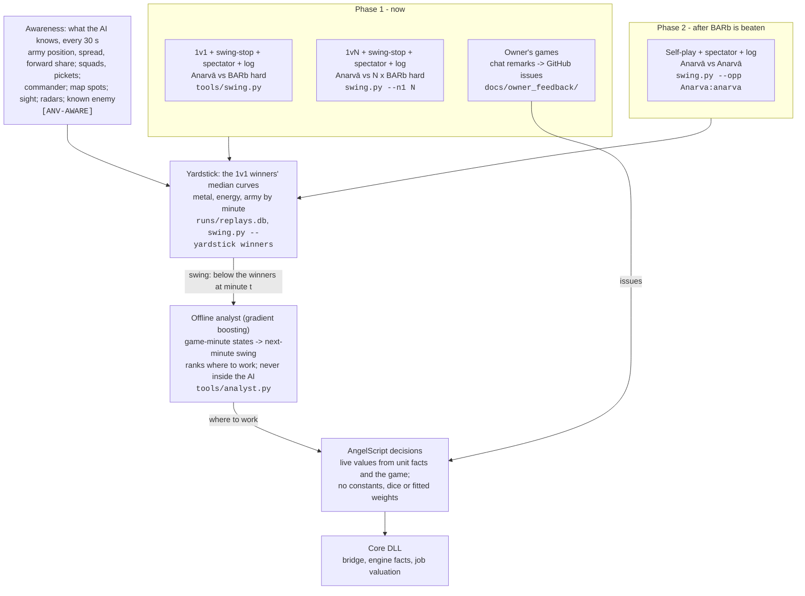
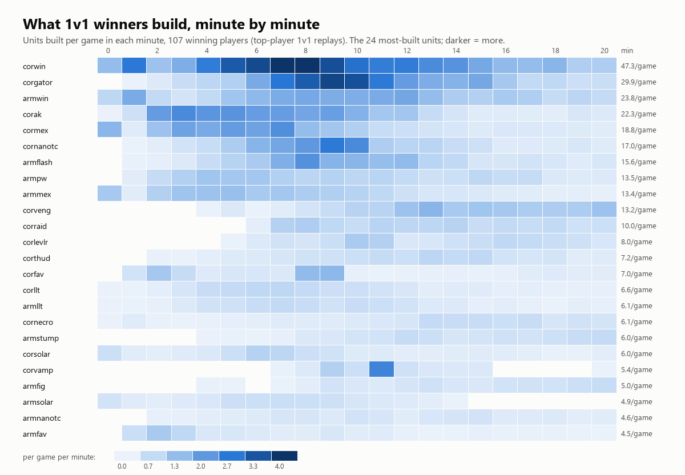
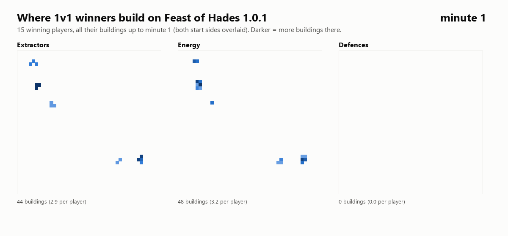
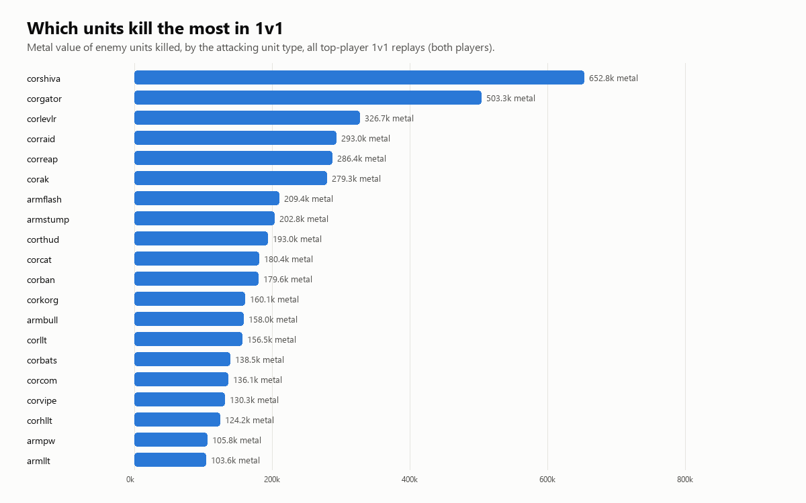
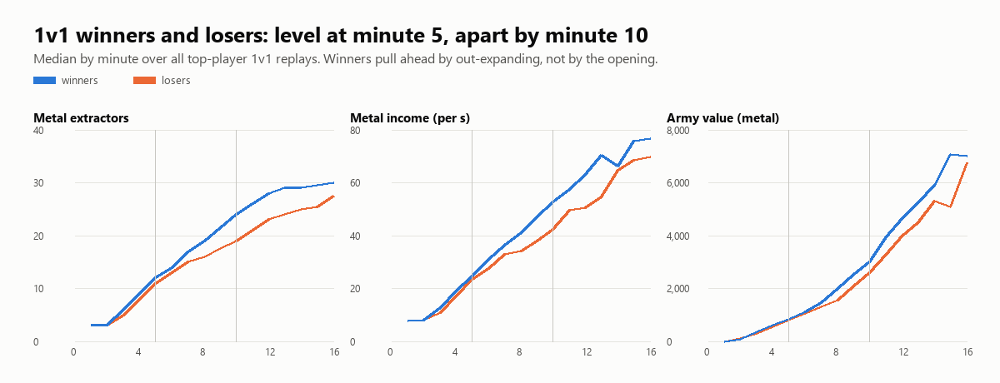
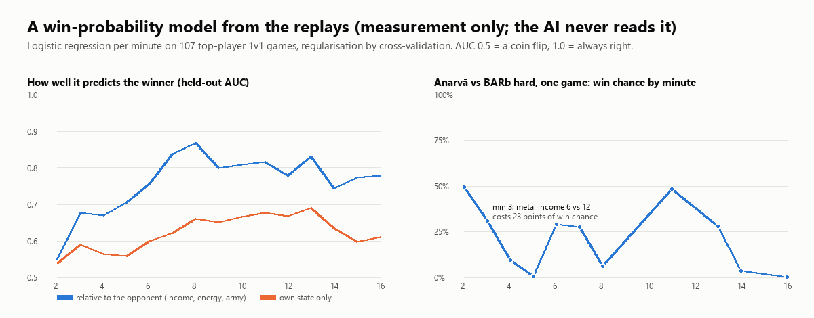
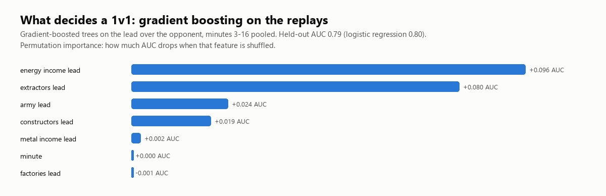

# Anarvā — a new AI and a data lab for Beyond All Reason

Two things in one repository:

- **A new AI.** It decides everything from the live game: values computed from unit facts and measured
  state, with no dice and no hand-picked constants. It runs on its own build of BARb's C++ core.
- **A BAR data lab.** Hundreds of top-player replays are played back headless and stored in one SQLite database:
  economy by minute, every unit built with time and place, kills by attacker and victim, commander tracks. The
  figures below come from it, and so does every claim the AI's decisions rest on (see [Replay study](#replay-study)).

## What "Anarvā" means

*Anarvā* comes from the Sanskrit *anarvan*: unrestrained, boundless, irresistible. In the Bhāgavata
Purāṇa (6.10), Anarvā is one of the generals who served under Vṛtrāsura, among the asura commanders
(with Namuci, Śambara, Puloma and others) who led his armies against Indra's devas. The name is the
design. BARb plays by arbitrary constraints: hand-tuned cutoffs, fixed timers, dice rolls, a build order
from a table. Anarvā removes them. Every choice is argued from the situation in front of it.

## Status (2026-11-26)

*1v1 winners from top-player replays (blue: median, band: middle half) against one Anarvā game versus BARb hard
(orange). Regenerate with `python tools/viz_replays.py --game runs/<batch>/gNN`.*

**Anarvā does not beat BARb yet.** It has not won a full-length 1v1 against BARb hard. The best three-game set so far
(Canis River, Armada against Cortex, 2026-11-26) traded 1.04 / 0.89 / 0.91 damage dealt per damage taken and kept the
commander alive in two, but lost on points: BARb's buildings stood at ~30k against ours at ~1.5k.

**Where it stands against the 1v1 winners:**
- **Fights:** about even now (trade 0.6–1.2, from 0.3–0.85). Units fire at what is in reach, fights are priced by the
  square law, and the army holds a position between fights (see *Armies* below).
- **The first six minutes:** about half the winners' income (~10 against 19 metal/s at 4:00) and a fraction of their
  army (5–17 combat units at 6:00 against 14–22).
- **Extractors:** 12–19 lost per game against the winners' ~2 by minute 12. Enemy buildings were never valued as ours
  are, so the army rarely hits BARb's economy (issue #107).

**Recent changes** (each a computed decision; what helped and what didn't is in [CLAUDE.md](CLAUDE.md)):
- **Army:** units fight what is in reach; fights are priced by the square law; revealed defences are inverted from the
  square law and forgotten once seen again; free units hold the median point of our extractors (*Hold*, #106).
- **Commander:** stays on ground it can watch and cloaks when standing is worth the energy (1v1 winners keep it near base).
- **Radar:** built from when the earliest enemy raid can arrive (it was never built before).
- **Tier 2:** taken when the upgrades' measured return beats the army's value per metal; every builder can assist an
  extractor upgrade.
- **Towers:** builders now take tower jobs at raided extractors (a BARb safety rule kept them away).
- **Opening:** walks priced by path length; start positions include the centre of each triangle of spots.

**Goal:** first 100% of 1v1 games against BARb hard, then one Anarvā against six BARbs on every map type.

## How Anarvā is developed

Owner's design, 2026-11-26. Phase 1 runs now; phase 2 starts once Anarvā beats BARb hard in 1v1.

| Part | State | Where |
|---|---|---|
| 1v1 lane (swing-stop, spectator, logs) | running | `tools/swing.py`, spectator agent notes in `docs/spectator/` |
| 1vN lane | available, not yet run | `swing.py --n1 N` |
| Owner's games | running | `docs/owner_feedback/`, GitHub issues |
| Self-play (phase 2) | available, waits for a 1v1 win | `swing.py --opp Anarva:anarva` |
| Yardstick: winners' curves | running | `swing.py --yardstick winners` (24 Armada bot-lab 1v1 wins) |
| Awareness | running | `[ANV-AWARE]` every 30 s |
| Offline analyst | first fit: R2 0.85 on held-out games (6787 game-minutes, 539 games, mostly older builds) | `tools/analyst.py` |

## How it decides

Anarvā runs on its own build of BARb's C++ core (CircuitAI plus [`core/circuitai.patch`](core/circuitai.patch))
with its own AngelScript brain (`Anarva/stable/script/anarva/misc/brain.as`). The rules (from
[CLAUDE.md](CLAUDE.md)):

- **No random numbers, no hand-picked constants.** A decision is a live comparison of value
  (metal-equivalent over the planning horizon, minus risk), from measured game state and unit facts. The
  only numbers allowed are game facts (frame rate, a unit's cost, range, speed), unit conversions and
  guards against division by zero.
- **Copy the reasoning behind what top players do, never their numbers.** Every strategic claim cites the
  replays it rests on.

Examples of what that means in practice:

| Decision | How it is computed |
|---|---|
| Planning horizon | how long what we own keeps paying before the enemy can take it: the time they need to build a force worth all we own, plus the time to cross the map |
| Which job a constructor takes | seconds until the job pays back at *shadow prices*: metal is worth nothing while it overflows, energy is priced at our own spending ratio while it is the bottleneck, and a job without a yield (lab, turret) is paid from stock and then income |
| How much energy | the energy needed to spend the metal we earn, at the energy/metal ratio of what our factories build. Converters' draw counts as surplus, not need |
| How many constructors | enough to claim the unclaimed extractor spots within the horizon (walk + build per spot), and only while we are not weaker than the enemy army we know of |
| Strength | each known enemy unit counted once, on the same Lanchester measure as ours: sqrt(dps × health). The commander's D-gun is excluded, since it fires only on order |
| When to tech | the upgrades' return over the producer life measured in this game (each upgrade earns from when it stands, at all our build power) must beat what the same metal buys as army |
| Reclaiming our own plants | only when a plant we can build now (not vent-bound) makes more energy per metal, and energy stays in surplus without it |
| Faction | from the commander that actually spawned: a random side resolves only then |

Every builder choice is logged with its alternatives (`[ANV-PICK]` lines: the job taken and the best job
of each other type, in seconds), so each economic decision can be read from the log.

## Replay study

500 games of leaderboard players (1v1 to 8v8, FFA) are downloaded to `ref/lib/` (see
[REPLAYS.md](REPLAYS.md)). `tools/replay_db.py run` plays each one back once, headless, with the analyzer widget, and stores
everything in SQLite (`runs/replays.db`), so no replay is ever played twice:

- per minute and player: metal and energy income, banked and storage, spending, army, defence and economy
  value, constructors, build power, extractors and their income, factories
- every unit built, with time, place and kind
- the damage and kill matrix by attacker unit and victim unit (for studying fights; the AI never reads it as a table)
- the commander's track, what it built and where it died

1v1 is parsed first. Progress: `python tools/replay_db.py status`.

**Milestones of the 1v1 winners** (107 winning players; when each first appears, and how many get there):

| Milestone | Games | Median | Middle half |
|---|---|---|---|
| First lab or plant | 103 | 1.1 min | 0.9–1.2 |
| First construction turret | 102 | 4.7 min | 3.7–5.7 |
| First T2 factory | 41 | 12.7 min | 9.7–16.0 |
| First T2 extractor | 34 | 14.9 min | 11.1–17.2 |
| First fusion | 24 | 16.6 min | 13.2–20.7 |
| First T3 gantry | 12 | 26.3 min | 24.3–30.8 |
| Juggernaut / Behemoth / Titan | 1 each | 41 / 46 / 33 min | |

**What winners build, minute by minute** (units built per game in each minute; the 24 most-built units):

Wind is built hardest between minutes 6 and 9. The raiders arrive in the same window: Grunts (`corak`) at minutes
2–6, Incisors (`corgator`) at 8–10. Winners build about 17 construction turrets per game, most of them at minutes
8–10.

**Where they build** (Feast of Hades, 15 winning players, both start sides overlaid, growing minute by minute):

Extractors cover the whole map. Energy stays packed in the two base corners, and defences sit along the middle and
the extractor fields.

**Which units kill the most** (metal killed by attacking unit type, both players, all 1v1 replays):

At T1 the Incisor (`corgator`), the Grunt (`corak`) and the Blitz (`armflash`) lead. The heavy units at the top come
from the longer games. Regenerate all three with `python tools/viz_units.py [--map "<map>"]`.

**Winners and losers** (median by minute, all top-player 1v1 replays):

Winners and losers are level at minute 5: 12 vs 11 extractors, army 826 vs 817. By minute 10 the winners lead with
24 extractors to 19 and 52.7 metal/s to 42.3. 1v1s are won by out-expanding after the opening, not by the opening
itself.

**More numbers from the 1v1 replays** (107 games, 214 players):

| | |
|---|---|
| Game length | median 14.9 min (middle half 11.6–22.5) |
| First factory, players / win rate | vehicle plant 76 / 55%, bot lab 130 / 48%, air plant 6 / 17% |
| Faction chosen, players / win rate | Armada 123 / 52%, Cortex 53 / 34%, random 38 / 66% |
| Commander deaths | recorded in 105 of the 107 games |

These are counts from this set of games, not a balance verdict: players who pick random may differ in skill from
those who pick a faction.

**A win-probability model** (machine learning, used for measurement only: the AI never reads it):

A logistic regression per minute, fitted on the 107 top-player 1v1 games, predicts the winner. Its regularisation
is chosen by cross-validation, with both players of a game kept in the same fold.
- **From a player's own state alone it barely can:** held-out AUC 0.54–0.69. Top players' economies look alike.
- **From the state relative to the opponent it predicts well:** AUC 0.67–0.87 from minute 3, peaking at minute 8.
  Here relative means the difference in metal income, energy income and army.
- **Energy income lead weighs most at most minutes.** With all six features (extractors, factories and
  constructors too), the extractor lead follows it at minutes 4–8.

**Gradient boosting** asks the same question of a model that can learn interactions:

It does no better (held-out AUC 0.79 against 0.80 for the logistic regression), so a 1v1's outcome follows a simple
weighted sum of leads. Two leads carry it: **energy income** and **extractors**. Army and constructors add a little.
Metal income adds almost nothing once extractors are known, since the two move together. Factory count adds nothing.
Run with `python tools/winprob.py boost`.

`tools/check_game.py` scores each of our games against BARb with it, using what the harness logs for both teams. For
each minute it shows our win chance and the gap that costs the most points. In the game above the first big cost
is metal income at minute 3: 6/s against BARb's 12, 23 points of win chance. Refit with `python tools/winprob.py fit`.
At minutes where cross-validation shrinks the model to its prior (its probabilities collapse to 50%), the report
says so instead of showing a number.

Most 1v1 games are decided at T1: only 41 of 107 winners build a T2 factory. Expansion, the first construction
turret by about five minutes, and the T1 army decide them. By 3:00 the winners average 8.4 wind turbines,
5 extractors, about 6 fighters and 0.2 towers.

## Armies: Anarvā against the 1v1 winners

The replay analyzer logs every player's army every 15 s: the alive armed units by type, their health, how many move,
their orders, the army's centre, and **squads** (units within the longer of two weapon ranges of each other are one
squad). Anarvā logs its own squads the same way (`[ANV-SQUAD]`). Six top-player 1v1 replays where Armada beat
Cortex (two on Canis River), against an Anarvā game on Canis River:

| | Winners | Anarvā |
|---|---|---|
| Combat units at 6:00 | 14–22 | 5 (8–17 with the latest changes) |
| Minutes 2–4 | single units spread over the map: scouting and raiding | 1–3 single units |
| Minutes 6–8 | one main squad of 9–18, groups of 2–7, singles | main squad 8, a second of 7 |
| Minutes 10–16 | main squad 20–33, a second of 10–19, small groups | main squad 9–14 |
| Army centre, minutes 6–8 | 1450–2300 from their start: in their own half, forward only when ahead | held at the median of our extractors since #106 |
| Orders, minute 8 | mostly standing (10 of 22, 21 of 27, 26 of 40 idle): holding | — |
| Losing players | keep moving and fragment (30 of 31 units moving at minute 6, in 13 pieces by minute 8) | |

**What the winners' main squad is made of** (share of its units):

| Window | Winners (Armada) | Losers (Cortex) | Anarvā |
|---|---|---|---|
| 0–6 min | Rover 55%, Pawn 24%, Tick 9%, Flash 9% | Grunt 46%, Rover 34%, Incisor 20% | a few Pawns |
| 6–10 min | **Flash 48%, Pawn 36%**, Mace 8% | Grunt 54%, Incisor 37% | Pawns, then Centurions |
| 10–16 min | Pawn 43%, Flash 21%, Mace 17%, Stumpy 14% | Incisor 56%, Thud 19%, Raider 15% | Centurion-led, Maces, Pawns |

**By metal spent on army** (28 Armada-beat-Cortex 1v1s, faction read from the commander):

| Window | Winners' army metal per game | Winners' mix | Anarvā |
|---|---|---|---|
| 0–4 min | 559 | Pawn 45%, Rover 25%, Flash 18%, Tick 9% | 233: Pawn 73%, Centurion 19% |
| 4–8 min | 2251 | Flash 42%, Pawn 29%, Mace 8%, Stumpy 5% | 1180: Centurion 61%, Pawn 37% |
| 8–12 min | 4590 | Flash 28%, Stumpy 25%, Pawn 10%, air ~9% | 3949: Centurion 72% |
| 12–16 min | 6478 | Stumpy 32%, Mace 13%, Flash 13%, air ~16% | 4841: Centurion 62%, Mace 25% |

What this says, as reasons (the AI never reads these tables): winners field a large army of cheap, fast units early,
from both a bot lab and a vehicle plant; they spread it to scout and raid, then concentrate one main squad that holds
their own half and pushes only when ahead; their core units are fast enough to reach where raids come. Squad and army
lines: `[REPLAY] SQUAD`, `[REPLAY] ARMY` (analyzer), `[ANV-SQUAD]` (Anarvā).

## The C++ core

The scripts see the battlefield through a bridge the patch adds:

| Script API | What it gives |
|---|---|
| `AiGetEnemies(...)` | every known enemy: position, velocity, type, metal cost, flags, health, build progress |
| `AiGetEnemyGroups(...)` | the core's clusters of enemy units: centre, metal, threat |
| `AiGetTeamUnits()`, `AiGetMetalSpots(...)`, `AiGetWrecks(...)` | our units, extractor spots, wrecks |
| `AiGetElevation(x, z)` and terrain queries | height, line of sight |
| `aiThreat.GetThreatAt(unit or def, pos)` | enemy fire a unit would take at a spot |
| `def.GetRangeAt(heightDiff)`, `def.CanBuild(def)`, `def.GetRadius()` | reach from a height, build options, footprint |

Unit facts the bridge can't see (build options, stockpile times, extraction, upkeep, geothermal vents,
commander metal make) are generated from the game's unit files by `tools/gen_facts.py` into `misc/facts.as`.

## Install

You need Beyond All Reason installed and started at least once (so it has downloaded an engine).

### From a release

1. Download the archive for your OS from the [latest release](https://github.com/hclivess/anarva-bar-ai/releases/latest):
   - Windows: `anarva-<version>-windows-x64.zip`
   - Linux: `anarva-<version>-linux-x64.tar.gz`
2. Extract it. Don't run the installer from inside the zip.
3. Run the installer: double-click `install.cmd` on Windows, or run `./install.sh` on Linux.

   It finds your BAR data folder. If it finds several or none, it asks you, and you can also pass the
   path as an argument. It copies `Anarva/stable` there together with Anarvā's own core library
   (`SkirmishAI.dll` / `libSkirmishAI.so`). The scripts need that core's bridge, so BARb's stock library
   won't run them.
4. The lobby lists only its built-in AIs by default. To show Anarvā:
   - Create an empty `devmode.txt` in the data folder (the installer offers to do it).
   - Restart the lobby.
   - Open **Settings → Developer** and untick **simple AI list**.

   Anarvā appears as **"Anarva stable"**.

Remove it with `install.cmd -Uninstall` / `./install.sh --uninstall`; `-DryRun` / `--dry-run` shows what
would happen without changing anything.

The last release (v0.1.0) predates the rework. A new release follows once Anarvā wins its 1v1s; until then,
build from source.

### From source (developers)

- Build the core under MSYS2 MinGW64 (`tools/build_dll.sh`, or `ninja -C ref/build BARb`).
- Deploy with `tools/install.ps1 -Name Anarva -Dll <built SkirmishAI.dll>`. It refuses, changing nothing, while
  a running BAR holds the library.
- Test one game at a time: `python tools/batch.py runs/<name> --games 1 --par 1 --me Anarva:anarva --opp BARb:hard
  --maps "<map>"`, then `python tools/check_game.py runs/<name>/g00`. That compares the game with the 1v1 winners,
  including the 3:00 build on the same map.
- `python build.py` self-tests the configs and writes the release archives to `dist/`.

### Windows says the script is not safe

The installer is a plain, unsigned script, so Windows may warn about it.

- **SmartScreen "Windows protected your PC"**: click **More info → Run anyway**.
- **Downloaded-file block**: unblock the zip before extracting (Properties → **Unblock**, or
  `Unblock-File .\anarva-<version>-windows-x64.zip`).
- **Check the download is ours**: compare `Get-FileHash .\anarva-<version>-windows-x64.zip -Algorithm SHA256`
  with the `.sha256` file on the release page. On Linux, run `sha256sum -c anarva-<version>-linux-x64.tar.gz.sha256`.
- If Defender flags it, report the false positive at <https://www.microsoft.com/wdsi/filesubmission>.

### Why there is no macOS build

Beyond All Reason ships only for Windows and Linux, and BARb's native library exists only as
`SkirmishAI.dll` and `libSkirmishAI.so`.

## Questions and answers

**Can one player really beat six BARbs?**
Yes. Public replays show humans alone beating 3–14 hard BARbs, and BAR's own scenarios pit one player
against up to seven ([STRATEGY.md](STRATEGY.md) §22).

**Why not copy a pro's build order?**
Balance changes and every game differs. Anarvā takes the *reason* a strong player does something (what
it buys, what it costs, in which situation) and computes the decision from the live game. Their numbers
are only the yardstick that Anarvā's results are compared against.

**How does it know what each unit is good against?**
From each unit's facts (range, speed, weapons, targets, health, cost), set against the enemy units it
actually sees in this game by the square law. There is no counter table: not BARb's, and not one built from
replays. A table is a frozen rule, and the right answer depends on the enemy actually in this game.

**Does it use transports, nukes, cloak, cameras?**

- **Anti-nuke:** built when an enemy *could* have a missile by the time ours would be ready.
- **Nukes, tactical launchers and shields:** built when their value beats their cost.
- **Cameras:** placed where the loss heatmap shows unseen losses.
- **Not yet:** transports and cloaked infiltration (issues #28, #75).

**Does it work online?**
Yes. Only the player hosting the AI needs it installed (see [Anarva/README.md](Anarva/README.md)).

## More

- [FEATURES.md](FEATURES.md): what the AI does now, by module.
- [STRATEGY.md](STRATEGY.md) and [TACTICS.md](TACTICS.md): the reasoning (Sun Tzu, Clausewitz, Lanchester,
  replays).
- [AUDIT.md](AUDIT.md): every removed random number and constant, and what replaced it.
- [PROGRESS.md](PROGRESS.md): test log.
- [GitHub issues](https://github.com/hclivess/anarva-bar-ai/issues): open work. Every remark from the owner's
  games becomes an issue.
- Developer tools in `tools/`:
  - `batch.py` and `run_match.py`: headless matches, including 1vN.
  - `replay_db.py`: the replay database.
  - `gen_facts.py`: unit facts.
  - `analyze_maps.py`: map analysis.

License: GPL-2.0, the same as CircuitAI and Beyond All Reason, which this is derived from.
